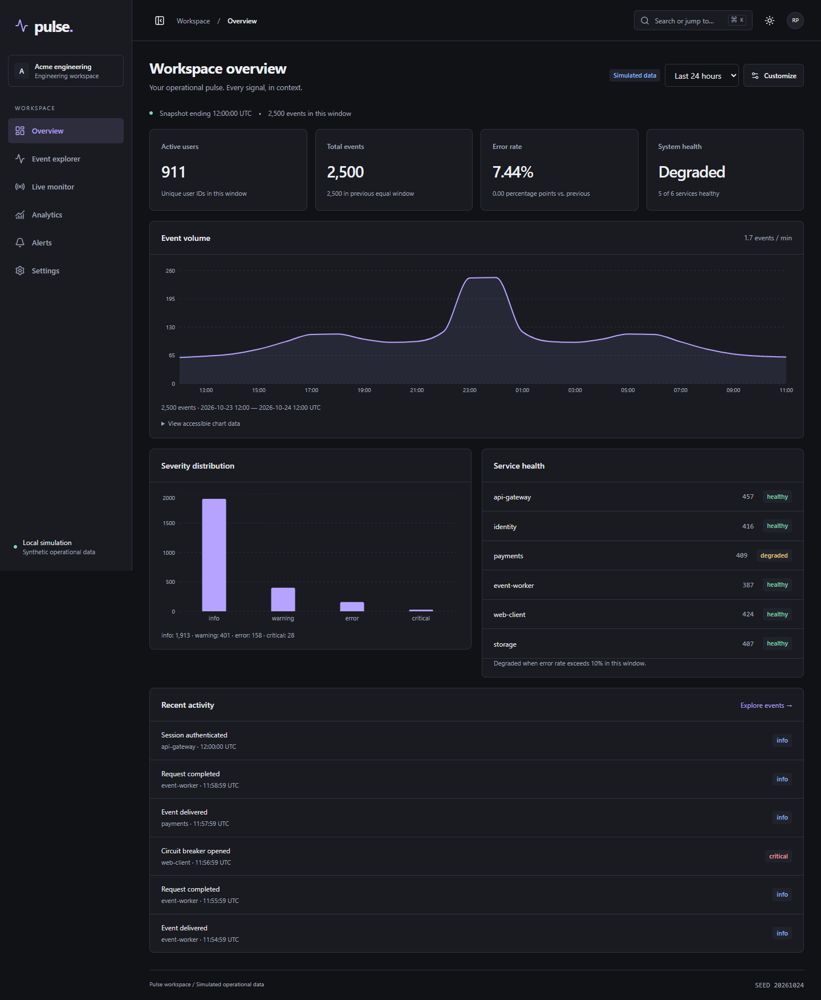

# Pulse

A frontend engineering workspace for investigating operational events, service health and incidents. Built with React 19, TypeScript, Vite and Tailwind CSS v4, with a REST/WebSocket simulator. All data is synthetic and clearly identified in the UI.



**Status: v1.0 release candidate (`1.0.0-rc.1`), not released.** The flagship is committed at `b54b296`; its [first GitHub Actions run passed](https://github.com/Kevin1skyrj/pulse-analytics/actions/runs/40012192211). Release hardening is on `codex/v1-release-hardening`. The owner will commit/push it; final-candidate CI remains a mandatory gate. [Release checklist](docs/release-checklist.md).

## Run locally

Use Node.js 22.16+ on the Node 22 line (verified locally with 22.16.0), npm, and two free loopback ports: 5173 and 3001. No accounts, paid services or secrets are required.

```sh
npm ci --legacy-peer-deps
npm run dev
```

Open http://127.0.0.1:5173. One command starts Vite and the TypeScript API server. Stop both with Ctrl+C. On Windows, use `npm.cmd` if PowerShell blocks `npm.ps1`.

The install flag is intentional: npm 11.4's peer resolver crashed while resolving the test tooling. The lockfile was generated with legacy peer resolution; application types, builds and runtime tests were then verified. It is not a claim that every package's declared peer range includes the newest preserved stack versions.

For a production preview, stop the development API on port 3001, then run:

```sh
npm run build
npm start
```

Open http://127.0.0.1:3001. The compiled Node server serves `dist/`, REST, WebSockets and SPA deep links on one origin. Local mode keeps alert/simulation editing available and refuses non-loopback binding. `npm run preview` remains an optional Vite asset preview requiring a separate development API; it is not the deployment entry point.

For hosting, use **public read-only mode** with a configured HTTPS origin. Alerts/simulation writes are denied by the server; browser preferences still work. [Exact deployment instructions and configuration](docs/deployment.md). No hosted service has been deployed.

## What works

| Area           | Implemented behavior                                                                                                                                        |
| -------------- | ----------------------------------------------------------------------------------------------------------------------------------------------------------- |
| Shell          | Six lazy routes, collapsible sidebar, modal mobile navigation, breadcrumbs, theme toggle, workspace identity                                                |
| Overview       | Consistent KPIs, volume chart, severity distribution, health and recent activity, 1/6/24-hour windows                                                       |
| Event explorer | Search, combined filters, UTC dates, primary/secondary sorting, URL state, 100/500-row pages, virtualization, columns, selection, copied IDs, detail drawer |
| Live monitor   | Actual WebSocket events, connection states, pause/resume, manual retry, bounded backoff, 500 ms batches, 300-event buffers                                  |
| Analytics      | Shared-data charts, previous-window comparisons, service cross-filtering, time-preserving investigation links, accessible chart tables                      |
| Alerts         | Validated create/edit, enabled state, evaluation against events, incident history, acknowledgement and resolution                                           |
| Customization  | Native desktop dragging, keyboard reorder buttons, grid width controls, visibility, persisted layout, restore defaults                                      |
| Productivity   | Ctrl/Command+K command entry, route and event search, persisted theme/workspace/density, simulation controls                                                |

## A five-minute local demonstration

1. Open **Overview**. Compare the total with chart bucket totals using **View accessible chart data**.
2. Open **Analytics**, choose a service and time window, then **Investigate events**. The selected window and service carry into the explorer URL.
3. Filter to errors, inspect an event, close with Escape, change columns and copy selected IDs. Copy the URL and reload to demonstrate shared investigation state.
4. In **Settings**, disable the stream and apply; open **Live monitor** to see retries. Re-enable the stream in another tab to see recovery. Pause the feed; received counts continue while display arrivals are paused.
5. In **Alerts**, create a rule for all services, error severity, threshold 1, window 1440 minutes. Open the resulting incident and acknowledge it. Resolving a still-breached rule can open a new incident on a later evaluation.
6. In **Overview → Customize**, move a widget, change its width or visibility, then reload. Use the arrow buttons as the keyboard/mobile alternative to dragging.
7. In **Settings**, freeze streaming and load **100,000** events. Explore a 500-row page while the DOM contains only visible rows plus overscan. Reset to 5,000 afterwards.
8. Try latency or every-Nth-request failures. **Reset conditions** remains available even during injected failures. To demonstrate an empty state, disable streaming before loading an empty dataset.

Seed: **20261024**. Starting clock: **2026-10-24 12:00 UTC**, with 48 hours of historical activity. Three events per simulation tick advance that clock; timestamps are not the current wall clock. See [data contracts and clock semantics](docs/data-flow.md).

## Quality checks

```sh
npm run lint
npm run typecheck
npm test
npm run build
npx playwright install firefox webkit
npm run test:e2e
npm run test:production
npm run benchmark
npm run test:soak
```

Local E2E tests use installed Google Chrome plus Playwright Firefox and WebKit. CI installs all three Playwright engines. Build first: Playwright starts its own compiled local-mode server on port 4175 with fresh in-memory state, then stops it. The suite never reuses your development server. The public-mode production smoke uses port 4174; the soak uses an ephemeral port. Keep those test ports free.

Verification includes lint, strict types, production build, 23 unit/component/API tests, a 36-scenario browser matrix, production smoke and a three-minute stream soak. Each browser scans all six routes in both themes at 375/768/1440 px with axe and page-overflow assertions. This is not a formal accessibility certification. [Recorded results, exact coverage and limitations](docs/testing.md).

The reproducible 5k/100k benchmark measures filtering, sorting and summary computation in Node, not end-to-end browser latency. The stream soak exercises 100k retained events and bounded buffers. [Measured results, conditions and bundle costs](docs/performance.md).

GitHub Actions is configured in `.github/workflows/ci.yml`. Baseline CI passed; the expanded release workflow must pass on the owner's final candidate commit before tagging.

## Architecture and dependencies

A feature-oriented SPA calls one small TypeScript HTTP/WebSocket process. Shared Zod contracts validate the boundary. React Router owns navigation; TanStack Query owns REST snapshots; component state owns forms/dialogs; a validated localStorage subscription owns preferences; a dedicated hook owns streaming lifecycle.

TanStack Virtual bounds mounted rows, Recharts supplies responsive charts/tooltips, Lucide supplies icons, and `ws` supplies actual sockets. No global state framework, table framework, drag framework, auth service or database is needed for the current demo. [Architecture](docs/architecture.md) · [Directory map](docs/project-structure.md) · [Tradeoffs](docs/tradeoffs.md).

## Study the implementation

| Module                     | Read and inspect                                                                                                   | Practical exercise                                                                                                                 |
| -------------------------- | ------------------------------------------------------------------------------------------------------------------ | ---------------------------------------------------------------------------------------------------------------------------------- |
| 1. HTML/CSS foundations    | `src/index.css`, `src/app/Shell.tsx`, [design system](docs/design-system.md)                                       | Explain `minmax(0,1fr)`, intrinsic sizing, breakpoints, landmarks and focus rings; change one spacing token and inspect all widths |
| 2. React composition       | [Component design](docs/component-design.md), `ui.tsx`                                                             | Trace props, children, conditional rendering and stable keys; explain when a dialog mounts/unmounts                                |
| 3. TypeScript contracts    | `shared/contracts.ts`, [data flow](docs/data-flow.md)                                                              | Explain unions, inferred types and why runtime validation is still necessary                                                       |
| 4. State ownership         | [State management](docs/state-management.md), explorer URL setters                                                 | Classify each state by lifetime; predict what survives reload, route change and server restart                                     |
| 5. REST/query lifecycle    | `src/services`, `server/app.ts`                                                                                    | Follow pending → success/error → retry; explain AbortSignal and cache keys                                                         |
| 6. Large lists and charts  | [Performance](docs/performance.md), `Events.tsx`, `Charts.tsx`                                                     | Explain pagination versus virtualization; reconcile one chart total with the KPI                                                   |
| 7. Real-time effects       | `useStream.ts`, WebSocket server                                                                                   | Draw connect → receive → disconnect → backoff; explain cleanup, refs, batches and bounded queues                                   |
| 8. Mutations and workflows | Alerts, Settings                                                                                                   | Explain validation, pending switch feedback, query invalidation and incident transitions                                           |
| 9. Quality and defense     | [Testing](docs/testing.md), [accessibility](docs/accessibility.md), [interview defense](docs/interview-defense.md) | Break one behavior deliberately, identify the test that should fail, then restore it                                               |

## Honest boundaries

This is a frontend demonstration with local mutable and public read-only modes. Rules/incidents are in memory and reset on server restart; public data resets every 24 hours of process uptime. Preferences are browser-local. Event retention is 100,000; live display is 300. Reconnection resumes future messages without cursor replay; retained gaps remain searchable over REST. There is no authentication, durable ingestion, notification delivery or deployed service. Manual screen-reader, real-device and extended browser-heap verification remain future work.

See [delivery report](docs/delivery-report.md), [before/after audit](docs/release-audit.md), [release notes](docs/release-notes.md) and [release checklist](docs/release-checklist.md). Module 02 was `d7a1abd`; the flagship is `b54b296`. Only the current hardening changes remain uncommitted. Commits and pushes remain the repository owner's responsibility.
