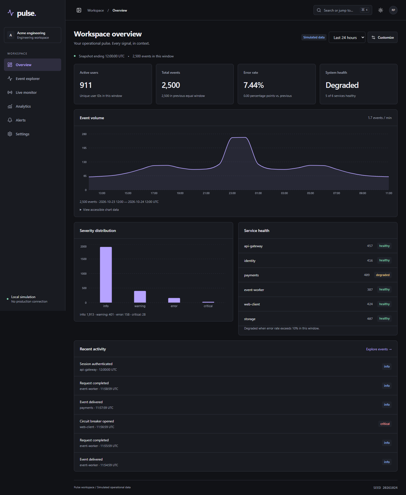

# Pulse

A frontend engineering workspace for investigating operational events, service health and incidents. Built with React 19, TypeScript, Vite and Tailwind CSS v4, with a local REST/WebSocket simulator. All data is synthetic and clearly identified in the UI.



## Run locally

Use Node.js 22.16+ on the Node 22 line (verified locally with 22.16.0), npm, and two free loopback ports: 5173 and 3001. No accounts, paid services or secrets are required.

```sh
npm ci --legacy-peer-deps
npm run dev
```

Open http://127.0.0.1:5173. One command starts Vite and the TypeScript API server. Stop both with Ctrl+C. On Windows, use `npm.cmd` if PowerShell blocks `npm.ps1`.

The install flag is intentional: npm 11.4's peer resolver crashed while resolving the test tooling. The lockfile was generated with legacy peer resolution; application types, builds and runtime tests were then verified. It is not a claim that every package's declared peer range includes the newest preserved stack versions.

For a production-asset preview, build first, run `npm run dev:api` in one terminal and `npm run preview` in another. The preview still needs the local API; deploying only `dist/` will not provide the simulator. No hosted deployment is included.

## What works

| Area           | Implemented behavior                                                                                                                                        |
| -------------- | ----------------------------------------------------------------------------------------------------------------------------------------------------------- |
| Shell          | Six lazy routes, collapsible sidebar, modal mobile navigation, breadcrumbs, theme toggle, workspace identity                                                |
| Overview       | Consistent KPIs, volume chart, severity distribution, health and recent activity, 1/6/24-hour windows                                                       |
| Event explorer | Search, combined filters, UTC dates, primary/secondary sorting, URL state, 100/500-row pages, virtualization, columns, selection, copied IDs, detail drawer |
| Live monitor   | Actual WebSocket events, connection states, pause/resume, manual retry, bounded backoff, 500 ms batches, 300-event buffers                                  |
| Analytics      | Shared-data charts, previous-window comparisons, service cross-filtering, time-preserving investigation links, accessible chart tables                      |
| Alerts         | Validated create/edit, enabled state, evaluation against events, incident history, acknowledgement and resolution                                           |
| Customization  | Native desktop dragging, keyboard reorder buttons, grid width controls, visibility, persisted layout, restore defaults                                      |
| Productivity   | Ctrl/Command+K command entry, route and event search, persisted theme/workspace/density, simulation controls                                                |

## A five-minute demonstration

1. Open **Overview**. Compare the total with chart bucket totals using **View accessible chart data**.
2. Open **Analytics**, choose a service and time window, then **Investigate events**. The selected window and service carry into the explorer URL.
3. Filter to errors, inspect an event, close with Escape, change columns and copy selected IDs. Copy the URL and reload to demonstrate shared investigation state.
4. In **Settings**, disable the stream and apply; open **Live monitor** to see retries. Re-enable the stream in another tab to see recovery. Pause the feed; received counts continue while display arrivals are paused.
5. In **Alerts**, create a rule for all services, error severity, threshold 1, window 1440 minutes. Open the resulting incident and acknowledge it. Resolving a still-breached rule can open a new incident on a later evaluation.
6. In **Overview → Customize**, move a widget, change its width or visibility, then reload. Use the arrow buttons as the keyboard/mobile alternative to dragging.
7. In **Settings**, freeze streaming and load **100,000** events. Explore a 500-row page while the DOM contains only visible rows plus overscan. Reset to 5,000 afterwards.
8. Try latency or every-Nth-request failures. **Reset conditions** remains available even during injected failures. To demonstrate an empty state, disable streaming before loading an empty dataset.

Seed: **20261024**. Starting clock: **2026-10-24 12:00 UTC**, with 48 hours of historical activity. Three events per simulation tick advance that clock; timestamps are not the current wall clock. See [data contracts and clock semantics](docs/data-flow.md).

## Quality checks

```sh
npm run lint
npm run typecheck
npm test
npm run build
npm run test:e2e
npm run benchmark
```

Local E2E tests use installed Google Chrome. CI installs Playwright Chromium. Browser tests reset the local dataset and simulation settings, so run them against a disposable demo instance, not an investigation you want to preserve. If the app is not running, Playwright starts it automatically.

Verified on 24 October 2026: lint, strict types and production build passed; 14 unit/component/API tests and 9 browser scenarios passed. The browser suite checks six routes in both themes with axe, mobile/tablet page overflow and critical workflows. This is not a formal accessibility certification. [Exact coverage and limitations](docs/testing.md).

The reproducible local 100k benchmark measured **153.37 ms median** for filtering, sorting and summary computation; that is a Node CPU measurement, not end-to-end browser latency. [Conditions and bundle costs](docs/performance.md).

GitHub Actions is configured in `.github/workflows/ci.yml`. Remote CI has not run for this uncommitted implementation.

## Architecture and dependencies

A feature-oriented SPA calls one small TypeScript HTTP/WebSocket process. Shared Zod contracts validate the boundary. React Router owns navigation; TanStack Query owns REST snapshots; component state owns forms/dialogs; a validated localStorage subscription owns preferences; a dedicated hook owns streaming lifecycle.

TanStack Virtual bounds mounted rows, Recharts supplies responsive charts/tooltips, Lucide supplies icons, and `ws` supplies actual sockets. No global state framework, table framework, drag framework, auth service or database is needed for the current demo. [Architecture](docs/architecture.md) · [Directory map](docs/project-structure.md) · [Tradeoffs](docs/tradeoffs.md).

## Study the implementation

| Module                     | Read and inspect                                                                                                   | Practical exercise                                                                                                                 |
| -------------------------- | ------------------------------------------------------------------------------------------------------------------ | ---------------------------------------------------------------------------------------------------------------------------------- |
| 1. HTML/CSS foundations    | `src/index.css`, `src/app/Shell.tsx`, [design system](docs/design-system.md)                                       | Explain `minmax(0,1fr)`, intrinsic sizing, breakpoints, landmarks and focus rings; change one spacing token and inspect all widths |
| 2. React composition       | [Component design](docs/component-design.md), `ui.tsx`                                                             | Trace props, children, conditional rendering and stable keys; explain when a dialog mounts/unmounts                                |
| 3. TypeScript contracts    | `shared/contracts.ts`, [data flow](docs/data-flow.md)                                                              | Explain unions, inferred types and why runtime validation is still necessary                                                       |
| 4. State ownership         | [State management](docs/state-management.md), explorer URL setters                                                 | Classify each state by lifetime; predict what survives reload, route change and server restart                                     |
| 5. REST/query lifecycle    | `src/services`, `server/app.ts`                                                                                    | Follow pending → success/error → retry; explain AbortSignal and cache keys                                                         |
| 6. Large lists and charts  | [Performance](docs/performance.md), `Events.tsx`, `Charts.tsx`                                                     | Explain pagination versus virtualization; reconcile one chart total with the KPI                                                   |
| 7. Real-time effects       | `useStream.ts`, WebSocket server                                                                                   | Draw connect → receive → disconnect → backoff; explain cleanup, refs, batches and bounded queues                                   |
| 8. Mutations and workflows | Alerts, Settings                                                                                                   | Explain validation, pending switch feedback, query invalidation and incident transitions                                           |
| 9. Quality and defense     | [Testing](docs/testing.md), [accessibility](docs/accessibility.md), [interview defense](docs/interview-defense.md) | Break one behavior deliberately, identify the test that should fail, then restore it                                               |

## Honest boundaries

This is a complete local frontend demonstration, not a deployed multi-tenant monitoring service. Rules/incidents are in memory and reset on server restart. Preferences are browser-local. Event retention is 100,000; live display is 300. Reconnection resumes future messages without cursor replay; retained gaps remain searchable over REST. There is no authentication, durable ingestion, notification delivery or production deployment. Broader browser and manual screen-reader testing remain future work.

See [delivery report](docs/delivery-report.md) for the feature matrix, verification evidence, important files and Git ownership. The existing baseline is `d7a1abd`; this implementation is deliberately **uncommitted**. Commits and pushes remain the repository owner's responsibility.
