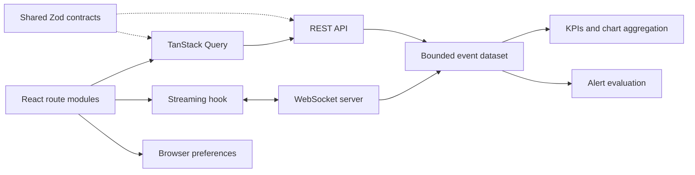

# Architecture

Pulse is a React 19 SPA and a TypeScript simulation server. In development Vite proxies `/api` and `/ws`; in production the compiled Node process also serves the built SPA on the same origin. Local mutable mode binds only to loopback. Public mode requires an exact HTTPS origin and rejects all mutation methods. There are no external accounts or paid services required locally.

`src/app` handles lazy routing and the persistent shell. `src/features` owns screen-specific behavior. Shared UI is deliberately small: panels, badges, query states, page titles and native dialogs. API serialization lives in `src/services`, runtime contracts in `shared`, and simulation behavior in `server`.

The server retains at most 100,000 events, 200 incidents and 100 rules. Public mode limits concurrent WebSocket clients and API requests and resets synthetic data every 24 hours of process uptime. A single process is sufficient for this demonstration. Rules are in memory; restarting resets them. This is a frontend portfolio simulation, not a production telemetry ingestion service. [Deployment and security assumptions](deployment.md).

The Module 02 commit is `d7a1abd`; the flagship implementation is committed at `b54b296`. Its capabilities remain: overview metrics, navigation, event search, keyboard focus and responsive layout. Static fixtures have been replaced by a coherent data source. Release hardening remains on a separate local branch until the owner commits/pushes it.
