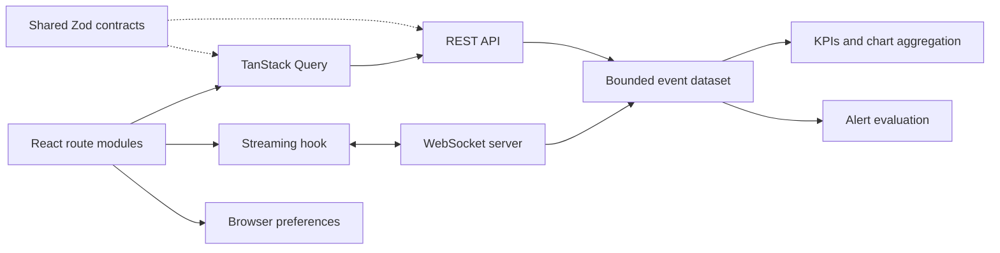

# Architecture

Pulse is a React 19 SPA and a loopback-only TypeScript simulation server. Vite proxies `/api` and `/ws`; both protocols share one server and dataset. There are no external accounts or paid services.

`src/app` handles lazy routing and the persistent shell. `src/features` owns screen-specific behavior. Shared UI is deliberately small: panels, badges, query states, page titles and native dialogs. API serialization lives in `src/services`, runtime contracts in `shared`, and simulation behavior in `server`.

The server retains at most 100,000 events and 200 incidents. A single process is sufficient for this demonstration. Rules are in memory; restarting resets them. This is a frontend portfolio simulation, not a production telemetry ingestion service.

The baseline Module 02 commit is d7a1abd. Its capabilities remain: overview metrics, navigation, event search, keyboard focus and responsive layout. Static fixtures have been replaced by a coherent data source. The flagship work is intentionally uncommitted at the user's request.
